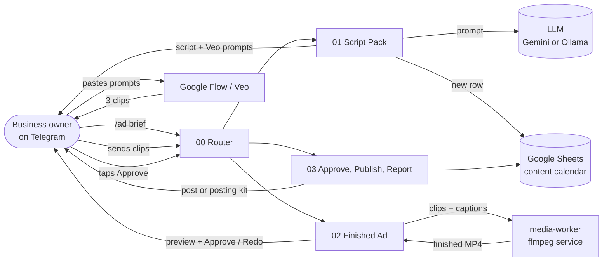
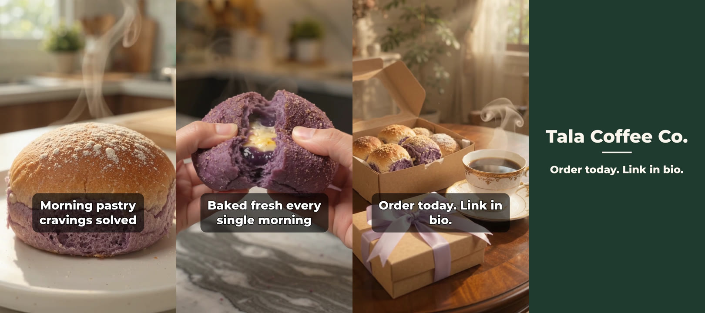

# AI Content Automation Pack

Turn a one-line product brief into a post-ready short video ad, from a Telegram chat.
Built with self-hosted **n8n**, an **LLM**, **Google Veo (Flow)**, **Google Sheets**, **Telegram** and a small custom **ffmpeg** service.

> Demo brand: "Tala Coffee Co.", a made-up coffee shop. Swap the brand in one settings file.

## Problem

Small businesses know they need short video ads (TikTok, Reels, Shorts) but:

- writing hooks, scripts and captions takes time they don't have;
- AI video tools produce raw 8-second clips, not finished ads;
- nobody tracks what was written, approved or posted.

## Solution

Three n8n workflows behind one Telegram bot. The owner never opens n8n.

| # | Workflow | What it does |
|---|----------|--------------|
| 01 | [Ad Brief to Script Pack](workflows/01-ad-brief-to-script-pack/) | `/ad Product \| benefit \| audience` → AI writes a 3-scene ad: on-screen text, voiceover, a ready-to-paste Veo prompt per scene, caption and hashtags. Saved to a Google Sheets content calendar. |
| 02 | [Clips to Finished Ad](workflows/02-clips-to-finished-ad/) | Owner sends the 3 generated clips → resized to 1080x1920, captions burned in, branded end card added → finished ad sent back with Approve / Redo buttons. |
| 03 | [Approve, Publish and Report](workflows/03-approve-publish-report/) | Approve → calendar updated, ad posted to a channel or a copy-paste posting kit sent. Every Monday → weekly report on Telegram. |
| 00 | [Telegram Router](workflows/00-telegram-router/) | The single entry point that passes each message to the right workflow. |



### Design choices worth noticing

- **Human in the loop.** The AI drafts, a person generates the clips and approves. Nothing is posted without a tap on Approve.
- **One bot, one router.** A Telegram bot can only deliver to one trigger, so a router workflow fans out to sub-workflows.
- **Swappable AI model.** The script writer talks to any OpenAI-compatible endpoint. Local Ollama for free testing, Gemini for quality. A JSON schema forces the answer into the right shape, and the workflow checks it again before using it.
- **Custom service where n8n stops.** n8n cannot run ffmpeg, so a 300-line FastAPI service ([worker/app.py](worker/app.py)) does the video work and n8n calls it over HTTP.
- **Only Telegram can reach the laptop.** A gateway ([gateway/Caddyfile](gateway/Caddyfile)) in front of the public tunnel blocks everything except the Telegram webhook path. The n8n editor stays local.
- **No secrets or personal IDs in the workflows.** Keys live in n8n credentials. IDs and brand settings live in `.env`.
- **Every failure answers the owner.** Each risky step has an error branch that sends a plain-language message to Telegram.

## Result

Measured on the first real run (one laptop, free tiers, 2026-11-13):

- One Telegram message produces a full script pack with Veo prompts in about 20 seconds (Gemini Flash-Lite).
- Three raw Google Veo clips became a 30-second captioned, branded vertical ad in under a minute, without opening a video editor.
- Every ad has a row in the content calendar with its status: `SCRIPTED` → `READY` → `APPROVED` → `POSTED`.

### Sample output

A real ad made by this pipeline. The script came from one Telegram message, the three clips were generated with Google Veo in Flow, and the bot joined them, added the captions and the end card.




[Watch the full 30-second ad](docs/sample/ad-pandesal-full.mp4)

The brief that produced it:

```
/ad Ube Cheese Pandesal | soft, baked fresh every morning | people who love premium pastries | English | luxurious, slow and elegant, no commentary, soft piano music only
```

## Run it yourself

Needs Docker Desktop, a Telegram account and a Google account. Full steps for beginners: **[docs/SETUP.md](docs/SETUP.md)**.

```powershell
copy .env.example .env
docker compose up -d
.\scripts\import-workflows.ps1 -WithPlaceholders
.\start.ps1
```

Then fill in the three credentials in n8n, publish the router, and send `/start` to your bot.

## What's in this repo

| Path | What it is |
|------|------------|
| `docker-compose.yml` | n8n, media-worker, gateway and tunnel |
| `workflows/` | One folder per workflow: `workflow.json` (n8n export), `README.md`, demo script |
| `worker/` | The ffmpeg video service (Python, FastAPI) |
| `gateway/` | Caddy config that only lets Telegram through |
| `scripts/` | Import and export workflows between n8n and this repo |
| `start.ps1`, `start.cmd` | Start everything and wire up the public address |
| `docs/SETUP.md` | Step-by-step setup |
| `HANDOFF.md` | State of the project, what's left, known gotchas |

## Bot commands

| Send this | What happens |
|-----------|--------------|
| `/ad Product \| benefit \| audience \| language \| style` | Writes a script pack. Language can be English, Tagalog or Taglish. Style is optional free text, for example `luxurious, slow, no voiceover, piano music only`. |
| a video (optionally with the ad code as caption) | Stores the clip. After the 3rd clip the ad is rendered. |
| `/render AD-XXXXX` | Renders now with the clips stored so far. |
| `/demo` or `/demo AD-XXXXX` | Renders with placeholder clips. Costs no AI video credits. |
| `/report` | Sends the weekly report now. |
| `/help` | Shows the commands and your chat ID. |
