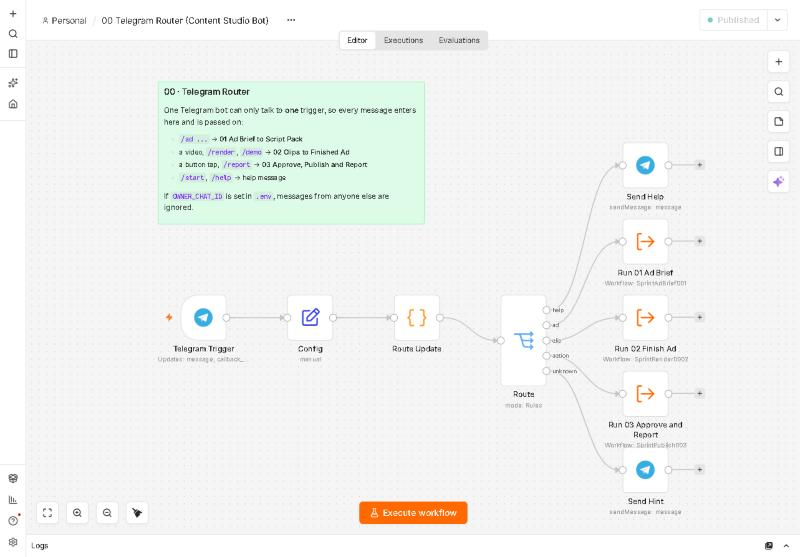

# 00 · Telegram Router

## Problem

A Telegram bot can deliver its messages to only **one** webhook. If three n8n workflows each have their own Telegram Trigger for the same bot, only the last one activated receives anything, and the other two go silent with no error.

## How it works

One workflow owns the only Telegram Trigger. It tidies each update into a small item and passes it on.

1. **Telegram Trigger** receives messages and button taps.
2. **Config** reads settings from `.env`.
3. **Route Update** (Code) extracts chat ID, text, command, video and button data, and decides the route. If `OWNER_CHAT_ID` is set, anyone else is ignored.
4. **Route** (Switch) sends the item on:

| The owner sends | Goes to |
|---|---|
| `/start`, `/help` | Help message, including their chat ID |
| `/ad ...` | [01 Ad Brief to Script Pack](../01-ad-brief-to-script-pack/) |
| a video, `/render`, `/demo` | [02 Clips to Finished Ad](../02-clips-to-finished-ad/) |
| a button tap, `/report` | [03 Approve, Publish and Report](../03-approve-publish-report/) |
| anything else | A short hint |

## Why it matters

Adding a new bot feature means adding one route here and one sub-workflow. The sub-workflows stay small, and each can also be called directly through its own API endpoint.
