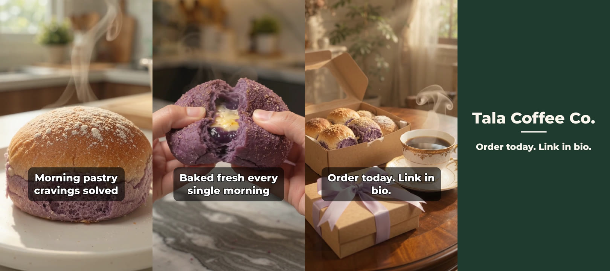

# 02 · Clips to Finished Ad


<!-- TODO: screenshot of the workflow canvas, plus one frame of a finished ad -->

## Problem

AI video tools such as Google Veo give you raw 8-second clips. A post-ready ad still needs the same boring edit every time: make everything vertical, join the clips, add captions, add a branded end card. That is 20 to 30 minutes in a video editor per ad.

## Solution

The owner sends the clips to the Telegram bot, in order. After the third clip the finished ad comes back in the chat with **Approve** and **Redo** buttons.

- Output is 1080x1920, 30 fps, H.264, ready for TikTok, Reels and Shorts.
- Captions come from the content calendar, so the owner can edit a caption in Google Sheets before sending clips.
- Landscape clips are not cropped: they are centered over a blurred copy of themselves.
- Captions sit above the area that app buttons cover.
- The original clip audio (Veo generates sound and speech) is kept.
- `/demo` runs the whole thing with placeholder clips, without spending AI video credits.

## How it works

| Step | Node | What it does |
|---|---|---|
| 1 | **From Telegram Router** / **API: POST render-ad** | A video, `/render`, `/demo`, or an API call |
| 2 | **Resolve Job** (Code) | Works out the mode and reads the ad code from the caption, if any |
| 3 | **Read Calendar** + **Pick Ad** | Finds the ad: the given code, or the newest ad still in progress |
| 4 | **What To Do** (Switch) | `clip`, `demo`, `render`, or `too_big` (Telegram bots can download 20 MB at most) |
| 5 | **Download Clip** → **Store Clip** | Gets the file from Telegram and uploads it to the media-worker |
| 6 | **Enough Clips?** | Fewer than 3: "Clip 2 of 3 saved". 3 or more: render |
| 7 | **Render Ad** (HTTP Request) | The media-worker builds the ad with ffmpeg |
| 8 | **Fetch Finished Video** → **Send Preview** | Sends the MP4 with Approve / Redo buttons |
| 9 | **Update Calendar** | Sets the row to `READY` and records the file |
| ! | **Tell Owner It Failed** | Every risky step reports its error in plain language |

### The media-worker

n8n has no ffmpeg and cannot run shell commands by default, so the video work lives in a small FastAPI service: [worker/app.py](../../worker/app.py). n8n calls it over HTTP inside the Docker network. Files land in `files/inbox/<ad code>/` and `files/out/<ad code>.mp4` on the laptop.

### API use

```bash
curl -X POST http://localhost:5679/webhook/render-ad \
  -H "Content-Type: application/json" \
  -d '{"mode":"demo","content_id":"AD-7KQ2M","texts":["Tired of bitter coffee?","Smooth vanilla oat","Your 3pm rescue"]}'
```

## Result



[Watch the full ad](../../docs/sample/ad-pandesal-full.mp4)


- 3 real Google Veo clips, sent in Telegram, became a finished 30-second ad (1080x1920, 10 MB) in under a minute on a 16 GB laptop.
- 3 placeholder clips to a finished 14.5-second ad: about 5 seconds of render time.
- Zero time in a video editor.

## Settings used

`MEDIA_WORKER_URL`, `BRAND_NAME`, `BRAND_CTA`, `BRAND_COLOR`, `SHEET_ID`, `OWNER_CHAT_ID`

Demo video script: [demo-script.md](demo-script.md)
