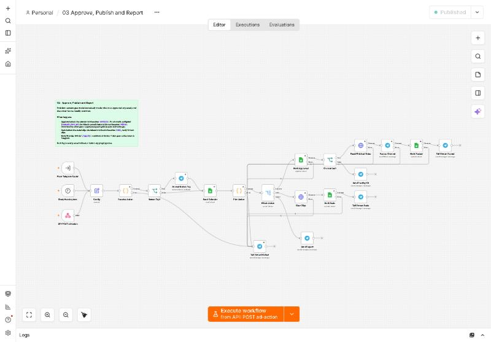

# 03 · Approve, Publish and Report



## Problem

Content gets made, then stalls. Nobody is sure which ads were approved, which were posted, and which are still waiting. The owner has no overview without opening a spreadsheet and counting.

## Solution

- **Approve** (button under the preview): the calendar row becomes `APPROVED`.
  - If a channel is configured, the ad is posted there with its caption and the row becomes `POSTED`.
  - If not, the owner gets a **posting kit**: caption and hashtags in a tap-to-copy block, ready for TikTok or Instagram.
- **Redo** (button): the stored clips are deleted and the row becomes `REDO`, ready for new clips. Redo is refused once an ad is approved, so an approval can't be undone by a stray tap.
- **Every Monday at 9:00**, or on `/report`: a summary of the last 7 days arrives on Telegram, with a list of ads waiting on the owner.

Nothing is ever posted without a person tapping Approve.

## How it works

| Step | Node | What it does |
|---|---|---|
| 1 | **From Telegram Router** / **Every Monday 9am** / **API: POST ad-action** | Three ways in |
| 2 | **Resolve Action** (Code) | Reads the action (`approve`, `redo`, `report`) and the ad code from the button |
| 3 | **Button Tap?** → **Answer Button Tap** | Stops the loading spinner on the Telegram button |
| 4 | **Read Calendar** + **Plan Action** (Code) | Finds the ad, or counts the week for the report |
| 5 | **Which Action** (Switch) | Splits into the three paths below |
| 6a | **Mark Approved** → **Channel Set?** → **Post to Channel** → **Mark Posted** | Approve path, with or without auto-posting |
| 6b | **Clear Clips** → **Mark Redo** | Redo path |
| 6c | **Send Report** | Report path |
| ! | **Tell Owner It Failed** | Every risky step reports its error in plain language |

### Example report

```
📊 Weekly content report · Nov 5 to Nov 12
Tala Coffee Co.

✍️ Scripts written: 5
🎞 Ads rendered: 3
✅ Approved: 2
📣 Posted: 2

From script to approved ad: 40%

Waiting on you
• AD-7KQ2M Vanilla Oat Cold Brew: needs your approval
• AD-9XH3P Ube Latte: needs clips
```

## Result

<!-- TODO: replace with numbers from a real week of use -->
- The owner approves from the phone in one tap.
- The calendar is always current without anyone typing into it.
- A weekly overview arrives without anyone asking for it.

## Settings used

`PUBLISH_CHAT_ID` (optional), `OWNER_CHAT_ID`, `SHEET_ID`, `BRAND_NAME`, `MEDIA_WORKER_URL`

Demo video script: [demo-script.md](demo-script.md)
